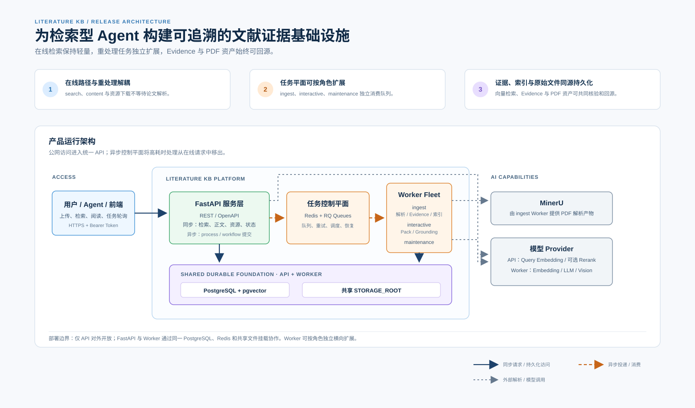

# Literature KB

Literature KB 是一个面向科研 / 检索型 agent 的文献证据库。它的定位不是“直接回答问题的 agent”，而是给 agent 提供一套稳定的文献基础设施：**论文入库、内容解析、证据检索、正文核验、PDF 回源、引用落地、工作流追踪**。

对 agent 来说，这套系统最重要的价值是：

- **可检索**：能在论文库中搜索论文与 evidence。
- **可阅读**：能读取论文正文窗口与 evidence 上下文。
- **可回源**：能把 evidence 还原到 PDF 页码、bbox 和相关资源。
- **可核验**：能把 search 命中的候选证据再做正文核验。
- **可生成引用产物**：能构建 Evidence Pack，也能对 draft 做 Citation Grounding。
- **可追踪状态**：能区分 paper processing task 与 workflow run，方便外部 agent 做轮询和恢复。

如果你是给 agent 组交付接入资料，建议先读完本文，再看 `docs/api.md`。按 OpenAlex
特定领域批量下载 PDF 并解析入库见
[`docs/openalex-batch-harvest-guide.md`](docs/openalex-batch-harvest-guide.md)；本地启动、
远程部署边界和可直接复用的 Agent 调用示例见
[`docs/local-development-agent-guide.md`](docs/local-development-agent-guide.md)；服务器
rootless Docker 部署见 [`docs/deployment.md`](docs/deployment.md)。

## 前端体验与接入指南

除了 API 文档，开发者可以直接通过前端控制台体验论文入库、检索、证据核验、工作流与模型管理，并在浏览器中查看可交互的接入指南：

```powershell
cd frontend
npm install
npm run dev
```

- 前端控制台：<http://127.0.0.1:5173/>
- 接入指南：<http://127.0.0.1:5173/docs/>

前端默认连接 `http://127.0.0.1:8000`；先按 [`docs/local-development-agent-guide.md`](docs/local-development-agent-guide.md) 启动后端，或通过 `VITE_API_BASE_URL` 指向目标 API。

## 架构概览



## 1. 它当前能做什么

### 论文与内容层

- 通过 OpenAlex、CORE、arXiv 搜索外部开放论文，并用 Unpaywall 补充 DOI 的 OA PDF 候选。
- 统一入口按 DOI / arXiv / PMID 等强标识符合并同一论文，同时保留所有来源和独立状态。
- 用户可指定导入来源；未指定时按版本和来源质量自动选择，失效后回退到下一来源。许可证作为来源元数据保留，不阻断技术上可直接获取的 PDF。
- 远程 PDF 暂存到本地或腾讯 COS 后登记为规范 `Paper`，并自动完成解析、Evidence、Embedding 与索引。
- 保留低层 discovery 下载接口用于“只暂存”，不会自动创建 `Paper`。
- 上传 PDF，创建论文记录。
- 对论文做 parse，生成 canonical content。
- 浏览论文摘要、年份、doi、venue、语言、处理状态与能力标记。
- 分页读取整篇论文正文窗口。

### Evidence 层

- 按自然语言 query 检索 evidence。
- 按已知 `paper_id` 浏览该论文已有 evidence。
- 读取 evidence 的上下文窗口，而不是只看检索 snippet。
- 将 evidence 回源到 PDF 位置、页码、bbox 与资源。

### 资源与关系层

- 浏览论文 assets，例如 pdf、figure、table、formula、image、attachment。
- 获取单个 asset 的元数据或下载其二进制内容。
- 浏览论文 references / citations。
- 浏览文内 citation contexts。

### Agent 工作流层

- **Evidence Pack**：输入显式 `claims[]`，返回 claim 到 evidence 的核验结果。
- **Citation Grounding**：输入 `draft`，自动抽取可核验 span，复用 Pack 结果并回填 citation marker。
- bibliography formatting：把显式 `paper_id` / `reference_id` 格式化成引文字符串。

### 状态与流程控制层

- 对 paper processing 的 `operations` 发起异步任务。
- 通过 `task_id` 查询 parse / build_evidence / enrich_multimodal / embed 的进度。
- 通过 `run_id` 查询 evidence pack / citation grounding 的进度与结果。

## 2. 给 agent 的典型使用步骤

### 最短调用链

```text
联合搜索 -> 确认导入 -> 下载暂存 -> 本地登记与处理 -> 检索 evidence -> 回源 source
```

### 路径 A：检索核验型 agent

适合“找到支持 / 反驳某个说法的证据，再给出可追溯出处”的 agent。

1. 调 `GET /api/v1/papers/meta-catalog` 看当前可用筛选和排序能力。
2. 需要先缩小论文范围时，调 `POST /api/v1/papers/search` 收集 `paper_id`。
3. 调 `POST /api/v1/evidence/search` 检索候选 evidence。
4. 对候选 evidence 调 `GET /api/v1/evidence/{evidence_id}/content` 做正文核验。
5. 需要页码、bbox、PDF 资源时，再调 `GET /api/v1/evidence/{evidence_id}/source`。
6. 如需附图、表格、公式等相关资源，可继续读取 `assets`。

### 路径 B：引用生成型 agent

适合“我已经有明确 claim 或 draft，需要生成可核验引用产物”的 agent。

1. 如果你已经知道目标论文范围，直接构造 `scope.paper_ids`。
2. 对显式 claims 调 `POST /api/v1/evidence/packs`。
3. 对 draft 调 `POST /api/v1/citations/ground`。
4. 使用 `GET /api/v1/workflows/{run_id}` 轮询结果。
5. 读取返回的 `claims`、`citations`、`unverified_claims`、`contradictory_evidence`。

### 这两类工作流要特别分清

- **Evidence Pack 处理的是显式 claims**。
- **Citation Grounding 处理的是 draft**。
- 二者都是**异步 workflow**，提交后拿到的是 `run_id`，不是最终结果。
- paper processing 用的是 **task**，workflow 用的是 **run**；它们是两套状态体系。

## 3. 关键设计原则

### canonical parser / canonical content 是基础事实源

系统会把论文解析成统一的 canonical content，并在此之上构建 evidence、source location、assets 和后续工作流结果。agent 应把它理解为“可追溯阅读与定位的基础层”。

### 检索与核验分离

`search` 的职责是给出候选证据，不是直接给出最终可引用结论。

- `POST /api/v1/evidence/search` 适合“找候选”。
- `GET /api/v1/evidence/{evidence_id}/content` / `source` 适合“做核验和回源”。

**search 命中 ≠ 可以直接引用**。要用于最终回答、引用或判断支持/反驳，应该继续读取 content/source。

### 工作流不替调用方做研究规划

Evidence Pack 不回答问题，也不替 agent 规划研究步骤。它只对调用方显式提供的 `claims[]` 做检索与核验。

### Grounding 尽量保持原 draft

Citation Grounding 的目标不是重写你的 draft，而是在服务端确定的 span 上补 citation marker，并输出哪些 claim 被支持、未核验或被反驳。

### scope 是 agent 控制检索边界的主要手段

agent 可以通过 `scope.paper_ids` 或 `scope.evidence_ids` 明确限制候选范围，避免“全库漫游式”检索，提高可控性与可解释性。

## 4. 能力边界 / 非目标

当前系统**不**承担以下职责：

- 不直接生成最终研究结论。
- 不保证 search 命中就一定能支持某个 claim。
- 不接受外部调用方伪造 citation grounding 的 span offset。
- 不把 workflow 的验证结果回写成 canonical paper data。
- 不替外部 agent 自动决定“该研究问题应该拆成哪些 claims”。

## 5. 你在接入时应该关注哪些对象

### Paper

代表一篇论文本身，关注点通常是：

- `paper_id`
- 元数据：`title`、`year`、`doi`、`venue`
- `processing_status`
- `capabilities`
- `asset_counts`

### Evidence

代表一个可检索、可定位、可核验的证据单元，关注点通常是：

- `evidence_id`
- `content.snippet` / `content.quote`
- `location.page` / `location.bbox`
- `assets[]`
- `modality` / `block_type`

### Task

代表 paper processing 的异步任务，例如：

- `ingest`
- `parse`
- `build_evidence`
- `enrich_multimodal`
- `embed`

### Workflow Run

代表 agent 工作流的异步运行，例如：

- `evidence_pack`
- `citation_grounding`

## 6. 典型交付方式：agent 怎么与它配合

### 场景 1：先缩小论文范围，再做 evidence 检索

```text
papers/meta-catalog -> papers/search -> evidence/search -> evidence/{id}/content -> evidence/{id}/source
```

### 场景 2：已有论文范围，直接做 claim 核验

```text
evidence/packs -> workflows/{run_id}
```

### 场景 3：已有一段 draft，要补引用和未验证标记

```text
citations/ground -> workflows/{run_id}
```

### 场景 4：需要自己灌库并等待处理完成

```text
papers (upload) -> papers/{paper_id}/operations/{operation} -> tasks/{task_id}
```

### 场景 5：先发现外部 OA 论文并暂存 PDF

```text
discovery/search -> discovery/works/resolve -> discovery/downloads
```

### 场景 6：按 OpenAlex 分类建立本地领域语料库

```text
taxonomy/search -> jobs/estimate -> harvest/jobs -> staged PDF
  -> harvest/jobs/{id}/imports -> register -> Pipeline
```

启用 `HARVEST_ENABLED=true` 后，左侧“批量采集”可按 OpenAlex
`Domain → Field → Subfield → Topic` 创建不限总量、可跨天恢复的任务。枚举使用
`topics.*.id` 高召回过滤和 cursor 深分页；不会默认限制 `primary_topic`、
`has_content.pdf`、`license` 或 `oa_status`。

完整的前端操作、API 自动化、状态判定、分批入库和故障恢复步骤见
[`OpenAlex 特定领域文献批量采集与解析入库指南`](docs/openalex-batch-harvest-guide.md)。

下载顺序为 OpenAlex Work 中的公开 PDF URL、Unpaywall、已配置的 CORE/arXiv，最后才使用
OpenAlex Content API。所有来源仍必须通过 HTTPS、公网地址、重定向次数、超时、大小和
`%PDF-` 校验，不会绕过登录、验证码、付费墙或 403。暂存对象使用：

```text
corpus/openalex/{work_id}/paper.pdf
corpus/openalex/{work_id}/metadata.json
```

管理员在“OpenAlex 采集”页集中添加获授权 API Key。Key 使用
`ADMIN_SECRETS_MASTER_KEY` 加密，Content 下载前读取 `/rate-limit` 并只在
`daily_remaining_usd` 足够时调度；`prepaid_remaining_usd` 仅展示，不参与预算。
生产环境使用独立 `worker-harvest`，CLI 固定为 `openalex-official==0.3.3`，Key 只通过
`OPENALEX_API_KEY` 环境变量传入。

暂存批量入库不会由 API 直接创建 RQ 作业；API 在单个事务中创建 `register`
pending task，由 Dispatcher 统一处理 Redis 故障与 Worker 租约恢复。
Harvest 的 `registered` 只表示 Paper 已注册，解析、内容构建、向量化和索引状态以关联
Pipeline 为准。模型 API 并发按每把 Key 独立配置，默认每把 5，总容量为所有健康 Key
容量之和。

外部发现与本地论文库是两个边界：`discovery/search` 不创建 Paper，`discovery/downloads`
只把通过网络、大小与 PDF 内容校验的文件和元数据 sidecar 写入本地 `storage/downloads/` 或已配置的腾讯 COS；许可证只记录，不参与下载判定。
`literature/search` 可联合查询本地、OpenAlex、CORE 与 arXiv；单个来源失败只会令响应
`partial=true`，不会丢弃其他来源结果。CORE 需要配置 `CORE_API_KEY`；arXiv 查询由 Redis
执行全进程每三秒一次的限流。`literature/imports` 接受多个 `{source, external_id}` 候选，
未指定 `preferred_source` 时自动失败回退，指定后只尝试该来源。调用方不能提交任意下载 URL。
远程解析与下载使用独立的 `literature-remote-fetch` 队列；下载完成后生成通用暂存 Artifact，
再由 `register` 阶段注册 Paper。Pipeline 把 Parse、Content、Embedding 与 Index 拆到独立队列，
通过 `PIPELINE_ENABLED` 启用；启用后 MinerU 等待采用短轮询任务，不再长期占用 worker，
Embedding API 变慢也不会阻塞解析或本地索引。生产默认 remote、parse、content、embedding
各两个 worker，index 一个；`BATCH_ACTIVE_WINDOW` 只用于兼容 V1。

## 7. 开发 agent 时建议先看哪里

### 先看本文

先理解：

- 这个系统的定位是什么
- 它提供哪些能力
- search、read、source、workflow 分别解决什么问题
- task 与 workflow 的区别是什么

### 再看 API 文档

详细接口说明见：[`docs/api.md`](docs/api.md)

建议阅读顺序：

1. `docs/api.md` 中的“总览与鉴权”
2. “Agent 推荐调用顺序”
3. “横切规则”
4. 你需要接入的接口分组

### 最后看机器可读契约

- `GET /openapi.json`：唯一机器可读事实源
- `GET /docs`：Swagger UI

如果你要开发真正调用这套文献库的 agent，**README 帮你理解能力和使用方式，`docs/api.md` 帮你落地具体请求与返回。**
